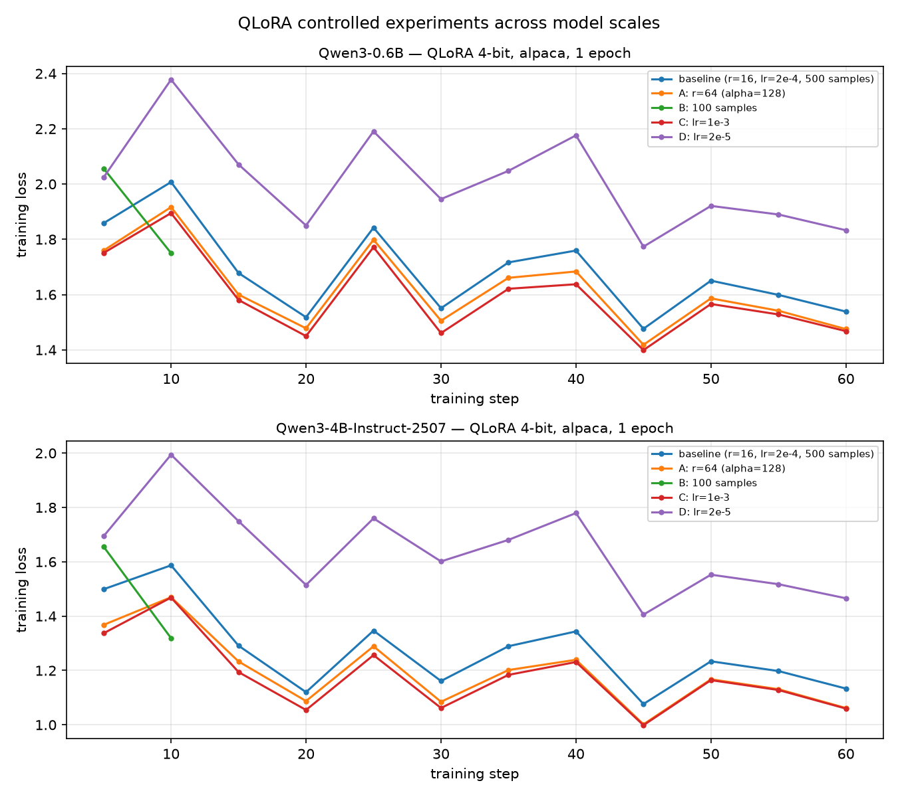

# QLoRA on a 12 GB Consumer GPU — Reproduction & Controlled Experiments

在单张 **RTX 5070（12 GB, Blackwell sm_120）** 上复现 QLoRA 微调，并完成四组受控对照实验。
这是「联邦 LoRA + 差分隐私」方向的第 0 步：先证明本地微调链路可复现、可度量，再把它包进联邦框架。

> **TL;DR** — 4-bit NF4 QLoRA on Qwen3-0.6B: 500 alpaca samples, 1 epoch in **~1 min**, peak VRAM **2.0 GB**,
> only **0.76%** of parameters trainable. Learning rate is the most sensitive knob (final loss 2.00 → 1.59 across lr 2e-5 → 1e-3).

---

## 结果速览

| 指标 | Qwen3-0.6B | Qwen3-4B-Instruct-2507 |
|---|---|---|
| 可训练参数（LoRA r=16） | 4.59 M / 600.6 M = **0.76%** | 11.8 M / 4.0 B = **0.29%** |
| 训练数据 | alpaca-cleaned，500 条，1 epoch，seq 512 | 同上（batch 1 × accum 8，等效 batch 一致） |
| 单次训练耗时 | **1.03 分钟** | **2.15 分钟** |
| 峰值显存 | **2.04 GB** | **4.20 GB**（卡有 12 GB） |
| 最终 loss（baseline） | 1.6765 | 1.2671 |
| 适配器体积 | 8.8 MB（实测 `adapter_model.safetensors`） | 约 24 MB（11.8 M × 2 B，bf16） |



---

## 环境

| 组件 | 版本 | 说明 |
|---|---|---|
| GPU | RTX 5070 12 GB | Blackwell，compute capability **sm_120** |
| 驱动 | 610.88 / CUDA 13.3 | 驱动足够新 |
| Python | 3.12.15 | 独立 venv |
| PyTorch | **2.14.1+cu130** | RTX 50 系必须 cu128/cu130，cu121 认不出这张卡 |
| transformers | 5.20.1 | |
| peft / trl | 0.21.2 / 1.16.0 | |
| bitsandbytes | 0.50.2 | Windows 有预编译轮子，不需要本地编译 |
| datasets / accelerate | 5.1.0 / 1.15.0 | |
| OS | Windows 11 22631 | 32 GB RAM |

详细的环境搭建过程（含国内镜像、踩坑与修复）见 [docs/ENVIRONMENT.md](docs/ENVIRONMENT.md)。

---

## 复现步骤

```bash
git clone https://github.com/LiuShengze/qlora-fedlab.git
cd qlora-fedlab
python -m venv .venv && . .venv/bin/activate     # Windows: .\.venv\Scripts\Activate.ps1

# CUDA 13 版 torch（Windows/Linux 都适用；RTX 50 系必须 cu128+）
pip install torch --index-url https://download.pytorch.org/whl/cu130
pip install -r requirements.txt

# 环境自检（GPU / 4-bit 内核 / 镜像配置）
python verify_env.py

# 单次训练 + 前后对比推理
python demo_qlora.py --samples 500

# 四组受控实验（约 6 分钟，输出 results/）
python experiments.py
```

Windows 用户可以直接跑 `setup_qlora.ps1` 一键装完（见 docs）。

---

## 实验设计与结果

固定变量：4-bit NF4、LoRA 注入 q/k/v/o、seq 512、1 epoch、seed 42、**等效 batch 8**
（0.6B 用 batch 2 × accum 4；4B 显存更紧，用 batch 1 × accum 8，保持等效 batch 相同才可比）。
**每次只改一个变量。**

<!-- RESULTS_TABLE_START -->
| 模型 | 实验 | r | alpha | lr | 样本 | 可训练参数 | 训练耗时 | 峰值显存 | 最终 loss |
|---|---|---|---|---|---|---|---|---|---|
| Qwen3-0.6B | baseline | 16 | 32 | 2e-4 | 500 | 0.764% | 1.03 min | 2.04 GB | **1.6765** |
| Qwen3-0.6B | A 秩加倍 | 64 | 128 | 2e-4 | 500 | 2.987% | 1.02 min | 2.15 GB | **1.6112** |
| Qwen3-0.6B | B 数据减到 1/5 | 16 | 32 | 2e-4 | 100 | 0.764% | 0.21 min | 1.97 GB | **1.9395** |
| Qwen3-0.6B | C 学习率放大 5× | 16 | 32 | 1e-3 | 500 | 0.764% | 0.99 min | 2.04 GB | **1.5872** |
| Qwen3-0.6B | D 学习率缩小 10× | 16 | 32 | 2e-5 | 500 | 0.764% | 1.01 min | 2.04 GB | **2.0033** |
| Qwen3-4B | baseline | 16 | 32 | 2e-4 | 500 | 0.292% | 2.15 min | 4.20 GB | **1.2671** |
| Qwen3-4B | A 秩加倍 | 64 | 128 | 2e-4 | 500 | 1.159% | 2.15 min | 4.47 GB | **1.1880** |
| Qwen3-4B | B 数据减到 1/5 | 16 | 32 | 2e-4 | 100 | 0.292% | 0.45 min | 4.16 GB | **1.5082** |
| Qwen3-4B | C 学习率放大 5× | 16 | 32 | 1e-3 | 500 | 0.292% | 2.13 min | 4.20 GB | **1.1722** |
| Qwen3-4B | D 学习率缩小 10× | 16 | 32 | 2e-5 | 500 | 0.292% | 2.13 min | 4.20 GB | **1.6382** |

<sub>可训练参数占比来自 `model.get_nb_trainable_parameters()`（peft 口径，分母是逻辑参数量；
直接用 `sum(p.numel())` 会因 4-bit 打包存储而低估分母，见踩坑第 3 条）。</sub>
<!-- RESULTS_TABLE_END -->

### 解读

**A. 秩 r：16 → 64（alpha 同步 32 → 128）**
0.6B：可训练参数 4.59 M → 18.35 M（4 倍），峰值显存 2.04 → 2.15 GB（+5%），loss 1.677 → 1.611。
4B：11.8 M → 47 M，显存 4.20 → 4.47 GB（+6%），loss 1.267 → 1.188。
两个规模上都是**参数涨 4 倍、显存只涨 5–6%**：LoRA 参数的梯度与优化器状态占比很小，
而 4-bit 底座权重和激活值的大头不随 r 变化。
→ 在 12 GB 卡上，r 不是显存瓶颈，**先加 r 再考虑换更大的模型**。

**B. 数据量：500 → 100 条**
0.6B：loss 1.68 → 1.94；4B：1.27 → 1.51。两个规模都**数据越少、训练集 loss 反而更高**。
原因：loss 是对 batch 的平均，样本少 → 更新步数少（25 步 vs 63 步）→ 模型还没学会格式模板。
结论：**在"还没学会"的阶段谈过拟合没有意义**，先保证步数够。

**C / D. 学习率：2e-4 → 1e-3 和 2e-5**
两个规模的排序完全一致：lr=1e-3 最好（0.6B 1.587 / 4B 1.172），lr=2e-5 最差（2.003 / 1.638），
且 2e-5 的曲线 12 步内几乎不降（欠拟合），1e-3 相邻步抖动更大（接近不稳定边界）。
→ **LoRA 的学习率比全量微调大一个量级**，但要卡在 1e-4 ~ 5e-4 区间。

### 规模对照（0.6B vs 4B）：结论迁移性

| 观察 | 0.6B | 4B | 结论 |
|---|---|---|---|
| baseline loss | 1.6765 | 1.2671 | 大模型同数据下 loss 低 **0.41**（约低 24%） |
| r 64 带来的 loss 改善 | −0.065 | −0.079 | 方向一致，4B 的收益**略大** |
| 100 条数据的 loss 惩罚 | +0.263 | +0.241 | 方向一致，幅度接近 |
| lr=1e-3 vs 2e-5 的差 | 0.416 | 0.466 | 方向一致，4B 对 lr 更敏感 |
| 可训练参数占比 | 0.764% | 0.292% | LoRA 参数按 hidden 维增长，慢于总参数 |
| 峰值显存 | 2.04 GB | 4.20 GB | 约为 2 倍，**远低于"7 倍参数 → 7 倍显存"** |
| 训练耗时 | 1.03 min | 2.15 min | 约 2 倍（batch=1 时 GPU 利用率低） |

**四条受控结论（r↑ → loss↓、数据↓ → loss↑、lr 过小欠拟合、lr 过大不稳）在两个规模上都成立**，
说明这些是 QLoRA 的结构性行为，而不是某个模型的偶然现象。

同时有两点值得写进报告的差异：
1. **绝对 loss 不可跨规模比较**（1.68 vs 1.27），只能同规模比较；
2. **4B 峰值显存只有 4.2 GB**，远低于按参数量线性外推的预期——因为 batch=1 时激活值很小，
   4-bit 权重只有约 2.4 GB。这意味着 12 GB 卡跑 4B **还有余量**（可以试 batch 2 或更长序列）。

---

## 评测：微调到底改变了什么（held-out，15 题 × 4 条件）

训练 loss 只能说明"拟合能力"，说明不了"回答变好没有"。所以另做了一组生成评测：
**15 道训练集里没有的题**（6 通用 + 4 技术 + 5 隐私/联邦），**4 个条件**，
统一 4-bit 加载、greedy 解码、`max_new_tokens=128`、同一 prompt 模板。

| 条件 | 底座 | adapter |
|---|---|---|
| 0.6B-base | Qwen3-0.6B | — |
| 0.6B-sft | Qwen3-0.6B | 500 条 alpaca 微调后 |
| 4B-base | Qwen3-4B-Instruct-2507 | — |
| 4B-sft | Qwen3-4B-Instruct-2507 | 500 条 alpaca 微调后 |

完整 60 条答案见 [results/eval.md](results/eval.md)，机器可读版 [results/eval.csv](results/eval.csv)。

### 三个主要发现

**1. 0.6B 微调前：会退化、会复读、会回显模板。**

例如 Q01 输出到第二句就开始重复"QQ 有更丰富的功能，比如可以发送图片、视频、音频"，Q02 结尾直接回显 `### Response:`。
Q12/Q14/Q15 则退化成整片 `###`。

**2. 0.6B 微调后：格式干净了，但变成"自信地胡说"。**

这是最值得写进报告的一点——微调**没有**让它更懂，只是让它更像在回答：

| 题 | 微调后的答案（节选） | 正确说法 |
|---|---|---|
| Q11 | "FedAvg 和 FedProx 是两个不同的 **Fed（Fedora）** 算法……两者的主要区别在于它们的权重分配策略。FedAvg 使用加权平均，而 FedProx 使用加权平均。" | Fed = Federated；FedProx 的区别是加了近端项 |
| Q13 | "LoRA（**Low Resource Approximation Transformers**）……通过引入一个**低资源近似器**来减少模型的计算和存储需求。" | Low-Rank Adaptation，低秩分解 |
| Q14 | "DP-SGD（**Dynamic Proximal Gradient Descent**）……首先使用了梯度的动量……其次使用了梯度的动量……" | 加噪 + 梯度裁剪 |

同一个问题在微调前是"明显混乱"（复读、`###`），微调后是"流畅但错误"——
**从"看得出它不会"变成"看不出它不会"，这在小模型上是容易被忽略的副作用。**

**3. 4B：底座本来就能答对，微调只改变了表达风格。**

4B-base 对 LoRA / DP-SGD / Non-IID / FedAvg 的回答基本正确；4B-sft 的对错几乎不变，
但答案更短、更像助手（Q04 直接从一段解释变成一句 `"Code reproduction" in English.`）。
因为 alpaca 里**没有**联邦学习或差分隐私的知识，微调无从注入。

### 结论

> 在**没有领域数据**的前提下，SFT 改变的是"回答的形态"（结构化、简短、不回显模板），
> 而不是"知识"。这一效应在小模型上表现为"从会复读变成会胡说"，
> 在大模型上表现为"同样的知识、更顺的语气"。

这也正好把下一步的方向标出来了：**要让隐私/联邦那 5 题变好，只能喂领域数据，不能靠调超参。**

### 局限（写报告时要声明）

- 15 道题、每条件单次 greedy 生成，没有多次采样；
- 未做人工打分（`results/eval.md` 末尾留了 1–5 分打分表）；
- 0.6B 是非 instruct 底座，本身不适合直接问答，这一点会放大"微调前后差异"。

---

## 复现 LoRA 论文的两条核心断言

### 断言 1：微调改变的是「表达」，不是「知识」

`analysis.py` 从 60 条评测输出里自动统计（无需人工判断），完整表见
[results/analysis.md](results/analysis.md)：

| 条件 | 平均长度 | 格式合规率 | 复读率 |
|---|---|---|---|
| 0.6B-base | 282 字 | 53% | **63.9%** |
| 0.6B-sft | 182 字 | **93%** | 36.7% |
| 4B-base | 257 字 | 73% | 24.1% |
| 4B-sft | 200 字 | **100%** | **19.4%** |

两个规模都是同一个方向：**格式合规率大幅上升、复读率明显下降、答案变短**——
也就是从“接着续写文档”转成“直接回答问题”。而事实对错没有改善（隐私题依旧答错）。

> 这就是 SFT 的作用边界：它校准的是**什么时候停、用什么结构答**，不是**答什么**。

### 断言 2：极少参数能达到接近全量微调的效果

同数据（500 条 alpaca）、同 seq 512、同等效 batch 8，只差在"训多少参数"：

| 方案 | 可训练参数 | 峰值显存 | 训练耗时 | 最终 loss |
|---|---|---|---|---|
| 全量微调 | 596 M（**100%**） | **5.60 GB** | 1.03 min | **1.5169** |
| LoRA r=16 | 4.59 M（**0.76%**） | 2.04 GB | 1.03 min | 1.6765 |

- 参数少 **130 倍**（100% → 0.76%），显存省 **2.7 倍**，训练速度**完全相同**；
- 代价是 loss 高 **0.16**（相对差约 10%）。

诚实说明：这个 0.16 是 **0.6B + 500 条 + 1 epoch** 这个特定设置下的结果，不能外推成
"LoRA 永远差 10%"。论文在 7B–65B、完整数据上观察到的是"基本持平"；
小模型 + 小数据往往对全量微调更有利，因为全量微调能更快拟合这 500 条样本。

另外全量微调的 `grad_norm` 一直在 8–16（LoRA 只有 0.3–1.7），说明它更不稳定、
更需要梯度裁剪——这也解释了为什么实践中更愿意用 LoRA。

### 我们复现了什么、没复现什么

| 复现了 ✅ | 没复现 ❌ |
|---|---|
| QLoRA 的显存收益（4-bit 量化 → 2.04 GB） | 论文 7B–65B 的绝对指标 |
| LoRA 的参数效率（0.76% 可训练） | GLUE / MMLU 等下游基准分数 |
| 微调改行为不改知识（60 条评测证据） | 大规模下 LoRA 与全量微调的收敛差距 |
| "接近全量微调"的方向（差 0.16 loss） | 推理延迟的定量对比（4-bit vs bf16） |

### 附：领域数据试跑（负结果，如实记录）

仓库里的 `data/lab_qa.jsonl` 是我们从组内 6 篇论文（FedShieldLLM、FedHLoRA、CITE、FKL、
FedFMSL、MuPFL）整理的 60 条问答，被用来做了一次"注入领域知识"的尝试：

| 设置 | 结果 |
|---|---|
| 0.6B + 60 条 × 3 epoch（23 步） | loss **4.0059**，峰值显存 1.15 GB |
| 训练后问「FedAvg 和 FedProx 的区别」 | 仍然答错，且出现循环表述 |

结论：**60 条、23 步、0.6B 这个组合不足以注入知识**。三个原因缺一不可——
数据太少（每个知识点只出现一次）、步数太少（loss 还没降下来）、模型容量不足（术语是它没见过的 token 组合）。

这条负结果本身是有价值的：它说明"喂一点数据就期待模型学会"是不成立的，
也解释了为什么本仓库把领域数据作为**下一步**而不是当前结论。要往下走需要：
扩到 150–200 条、训 10–15 epoch、并在 4B 上做（容量更够）。

---

## 学习脚本（learn/）

这三个小脚本是理解 QLoRA 的"脚手架"，每个只做一件事，跑一次约 30 秒：

| 脚本 | 看什么 | 你会理解 |
|---|---|---|
| `01_tokenizer.py` | 一句话变成 id、再还原成 token | 模型不认字；`QLoRA` 被切成 `QL`+`o`+`RA`，`微` 甚至要 2 个 token |
| `02_next_token.py` | 逐位置 top-3 预测 vs 实际下一个 token | LLM 的全部能力就是"预测下一个 token"；高概率处是背下来的搭配 |
| `03_fp16_vs_int4.py` | 同一模型 bf16 与 4-bit 加载的显存 | 0.6B：1.11 GB → 0.50 GB（2.2×，不是理论上的 4×，因为有量化开销） |
| `99_check_peft_path.py` | — | 库装在哪、怎么查源码，排查问题时用 |

> 顺序建议：01 → 02 → 03 → 再读 `demo_qlora.py`。先有"token / 下一个词 / quantized 存多少"三个直觉，
> 再去看训练代码，就不会觉得是黑箱。

---

## 目录结构

```
.
├── demo_qlora.py        单次 QLoRA 微调 + 微调前后对比推理
├── experiments.py       四组受控实验（支持 --model 跑多规模），自动出表格与曲线
├── eval.py              15 题 × 4 条件的 held-out 生成评测
├── analysis.py          从 eval.csv 自动统计格式/复读/长度
├── full_ft.py           全量微调对照（验证 LoRA 的参数效率）
├── verify_env.py        环境自检（GPU/算力匹配/4-bit 内核/镜像）
├── requirements.txt
├── setup_qlora.ps1      Windows 一键环境（可选）
├── learn/               学习脚本：tokenizer / next-token / fp16 vs 4-bit
├── data/
│   ├── lab_qa.jsonl     组内 6 篇论文的 60 条问答（改写，非原文）
│   ├── build_lab_qa.py  生成脚本
│   ├── validate_qa.py   数据校验（字段/长度/重复/乱码）
│   └── papers/          论文提取出的纯文本（含原文，已在 .gitignore 外，不入库）
├── results/             results.csv / results.md / loss_curve.png / curves.json
│                        eval.csv / eval.md / analysis.md
└── docs/
    ├── ENVIRONMENT.md        环境搭建全记录（含镜像与踩坑）
    └── download_model.ps1    国内下载大模型（ModelScope 优先 + 断点续传）
```

---

## 踩坑记录（工程细节）

复现别人的 QLoRA 教程时实际撞到的坑，都已在本仓库修好：

1. **RTX 50 系 = sm_120**，`pip install torch` 装到的默认版本没有对应内核，必须显式指定 cu128/cu130。
2. **Windows + bitsandbytes** 没问题（0.50.x 有 `win_amd64` 轮子），但要先装对 torch，否则加载 4-bit 时报 DLL 缺失。
3. **4-bit 参数量口径容易算错**：`sum(p.numel())` 在量化权重上是"打包后"的元素数（380 M），
   会得到 1.21% 这种偏差值；正确做法是用 `model.get_nb_trainable_parameters()`（600.6 M 分母，0.76%）。
4. **trl 1.x 的 API 变了**：`max_seq_length` → `max_length`，`tokenizer=` → `processing_class=`，
   并且 `formatting_func` 不传的话模板根本不会生效（不报错，静默失效）。
5. **hf-mirror 下载 1.4 GB 大文件会"假死"**（停在某个字节数不报错），用 `curl --max-time 60 -C -` 循环续传解决。
6. **hf-xet 协议在镜像上会 401**，设 `HF_HUB_DISABLE_XET=1`。
7. 反量化计算用 `bnb_4bit_compute_dtype=torch.bfloat16`，**T4 等 Turing 卡不支持 bf16**，要改 fp16。

---

## Roadmap

- [x] 本地 QLoRA 链路跑通（0.6B / 12 GB 卡）
- [x] 四组受控实验 + 结果归档（0.6B / 4B 双规模）
- [x] held-out 生成评测（15 题 × 4 条件）
- [x] 全量微调对照 + 生成质量量化统计
- [ ] 换成组内论文构建的领域问答数据（100–300 条），4B 模型
- [ ] 用 Flower 把 `train()` 包成 client，2–4 客户端、每轮 FedAvg 聚合 **LoRA 适配器**
- [ ] 本地训练加 Opacus DP-SGD，测 ε 与效用的权衡曲线

## 参考

- Dettmers et al., *QLoRA: Efficient Finetuning of Quantized LLMs*, 2023
- HuggingFace PEFT / TRL / bitsandbytes
